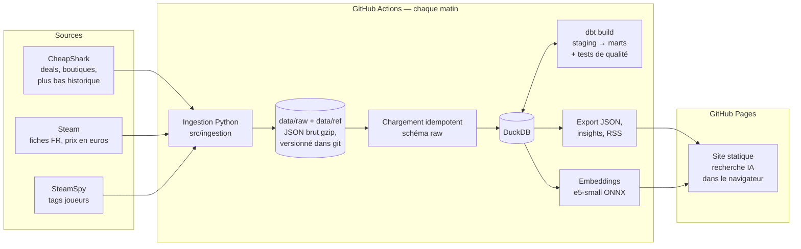

# Deal Hunter

Les promos sur les jeux PC, comparées entre une trentaine de boutiques, avec l'historique des prix pour savoir si une promo vaut vraiment le coup, et une recherche en langage naturel (« un roguelike pas cher pour jouer à deux »).

**Site : https://slfire.github.io/deal-hunter/** · [Les chiffres du marché](https://slfire.github.io/deal-hunter/insights.html) · [Flux RSS](https://slfire.github.io/deal-hunter/feed.xml)

Le projet est un pipeline de données complet qui tourne tout seul chaque matin, sans serveur et sans coût : ingestion de plusieurs API, warehouse DuckDB modélisé avec dbt, tests de qualité, embeddings pour la recherche sémantique, et publication d'un site statique.

## Architecture



| Étape | Ce qu'elle fait | Code |
|---|---|---|
| Ingestion | Snapshot quotidien des ~3 000 deals (pagination, retry/backoff, User-Agent identifié), plus bas historique par lots de 25, prix Steam en euros par lots de 50 | `src/ingestion/` |
| Référentiels | Fiches Steam et tags SteamSpy mis en cache, récupération incrémentale et bornée par run, reprise propre en cas de panne de la source | `src/ingestion/common.py` |
| Stockage brut | Réponses des API gardées telles quelles, compressées, horodatées par le chemin : on peut tout rejouer | `data/raw/`, `data/ref/` |
| Chargement | Chaque fichier n'est chargé qu'une fois (table `raw._loaded_files`) | `src/transform/build_warehouse.py` |
| Modélisation | dbt : `staging` (typage, faux zéros → NULL, dédoublonnage) puis `marts` | `dbt/models/` |
| Qualité | Tests dbt (unicité, non-nullité, relations, grain de l'historique, cohérence des prix) + pytest | `dbt/tests/`, `tests/` |
| Recherche IA | Vecteurs des jeux calculés en CI, requête vectorisée dans le navigateur avec le même modèle | `src/ml/`, `site/index.html` |
| Publication | JSON statiques, page Insights, flux RSS, déploiement GitHub Pages | `src/export/`, `site/` |

## Modèle de données

- **`marts.fct_price_history`** : un prix par jeu × boutique × jour. C'est la table de faits qui servira à prédire les promos.
- **`marts.dim_games`** : un jeu par ligne, enrichi : plus bas prix historique (le plus bas entre CheapShark et nos propres relevés), description et genres Steam, tags joueurs, mode coop, prix en euros.
- **`marts.dim_stores`** : les boutiques.
- **`marts.current_deals`** : les offres du dernier snapshot, prêtes pour le site.
- **`marts.insights_store_stats`** : quelle boutique est la moins chère le plus souvent, réduction moyenne, etc.

Pour voir la documentation et le lignage générés par dbt :

```bash
cd dbt && dbt docs generate && dbt docs serve
```

## La recherche en langage naturel

1. Chaque matin, chaque jeu est résumé en un texte (tags joueurs, genres, mode coop, développeur, description) puis transformé en vecteur par `multilingual-e5-small`, dans sa version ONNX quantifiée. Les vecteurs sont stockés en int8 (~0,5 Mo pour 1 400 jeux).
2. Dans le navigateur, les contraintes de la phrase sont d'abord reconnues et deviennent de vrais filtres (« pas cher » → moins de 10 $, « à deux » → coop, « bien noté »…).
3. Le reste de la phrase est vectorisé sur place avec Transformers.js, **avec exactement le même fichier de modèle**, puis comparé aux jeux. Le score final combine la proximité de sens, les mots retrouvés dans les tags et un léger bonus de qualité.

Aucune clé d'API, aucun serveur : le modèle n'est téléchargé que si l'utilisateur active la recherche IA.

## Lancer en local

```bash
python -m venv .venv && source .venv/bin/activate
pip install -r requirements.txt
echo "DEALHUNTER_CONTACT=ton.mail@example.com" > .env

python src/ingestion/snapshot.py --max-pages 3     # quelques pages de deals
python src/ingestion/games_info.py                 # plus bas historique
python src/transform/build_warehouse.py            # chargement + dbt build
python src/export/export_site_data.py
python -m http.server -d site 8000                 # http://localhost:8000
```

Les étapes Steam et SteamSpy (`steam_details.py`, `steamspy_tags.py`, `steam_prices.py`) et les embeddings (`src/ml/embed_games.py`) se lancent de la même façon.

Tests :

```bash
python -m pytest
```

## Choix techniques

- **DuckDB plutôt qu'un serveur de base de données** : quelques millions de lignes à terme, un seul fichier, zéro administration, et dbt le supporte nativement.
- **Le brut versionné dans git** : ~100 Mo par an compressé, ça tient largement et chaque snapshot est traçable. Au-delà, bascule prévue vers un stockage objet (Cloudflare R2).
- **Les étapes d'enrichissement ne bloquent jamais le site** : si Steam ou SteamSpy tombent, le pipeline publie avec les données disponibles.
- **Tests dbt en `warn`** : une anomalie de données prévient sans bloquer la publication ; une erreur de modèle, elle, bloque.

## Prochaine étape

Prédire, pour chaque jeu, la probabilité d'une baisse de prix dans les 14 jours, à partir de `fct_price_history` et des plus bas historiques, dès qu'il y aura quelques semaines de relevés.

## Sources

Prix et boutiques : [CheapShark](https://www.cheapshark.com) · Fiches et prix en euros : Steam · Tags joueurs : [SteamSpy](https://steamspy.com).
