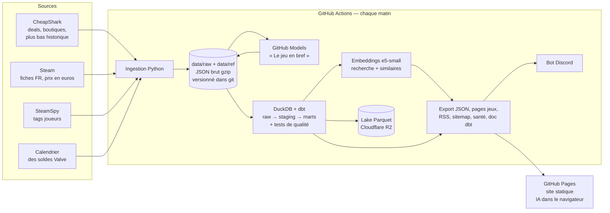

# Deal Hunter

Les promos sur les jeux PC, comparées entre une trentaine de boutiques, avec l'historique des prix pour savoir si une promo vaut vraiment le coup, une recherche en langage naturel (« un roguelike pas cher pour jouer à deux ») et un résumé IA « Le jeu en bref » pour chaque jeu.

**Site : https://slfire.github.io/deal-hunter/** · [Les chiffres du marché](https://slfire.github.io/deal-hunter/insights.html) · [Santé du pipeline](https://slfire.github.io/deal-hunter/sante.html) · [Documentation des données](https://slfire.github.io/deal-hunter/docs/) · [Flux RSS](https://slfire.github.io/deal-hunter/feed.xml)

Le projet est un pipeline de données complet qui tourne seul chaque matin, sans serveur et sans coût : ingestion de cinq sources, warehouse DuckDB modélisé et testé avec dbt, embeddings et LLM pour la partie IA, lake Parquet, observabilité, et publication d'un site statique.

## Architecture



| Étape | Ce qu'elle fait | Code |
|---|---|---|
| Ingestion | Snapshot quotidien des ~3 000 deals (pagination, retry/backoff, User-Agent identifié), plus bas historique par lots de 25, prix Steam en euros par lots de 50 | `src/ingestion/` |
| Référentiels | Fiches Steam, tags SteamSpy : caches incrémentaux bornés par run, réponses inattendues sautées, arrêt propre si la source tombe | `src/ingestion/common.py` |
| Stockage brut | Réponses des API gardées telles quelles, compressées, horodatées par le chemin : tout peut être rejoué | `data/raw/`, `data/ref/` |
| Modélisation | Chargement idempotent (`raw._loaded_files`), puis dbt : `staging` (typage, faux zéros → NULL, dédoublonnage) et `marts` | `src/transform/`, `dbt/` |
| Qualité | 31 tests dbt (unicité, non-nullité, relations, grain de l'historique, cohérence des prix) + 22 tests pytest en CI | `dbt/tests/`, `tests/` |
| IA | « Le jeu en bref » par LLM, recherche sémantique, jeux similaires | `src/ml/` |
| Publication | JSON du site, une page HTML par jeu (SEO, aperçus de partage), sitemap, flux RSS, bot Discord | `src/export/`, `site/` |
| Lake | Tables en Parquet partitionné, poussées sur Cloudflare R2 si configuré | `src/lake/` |
| Observabilité | Fraîcheur, volumes par jour, couverture des enrichissements, tests dbt, historique des runs | `src/export/build_health.py`, `site/sante.html` |

## Modèle de données

- **`marts.fct_price_history`** : un prix par jeu × boutique × jour. C'est la table de faits qui servira à prédire les promos.
- **`marts.dim_games`** : un jeu par ligne, enrichi : plus bas prix historique (le plus bas entre CheapShark et nos relevés), fiche Steam, tags joueurs, mode coop, prix en euros, résumé IA « Le jeu en bref ».
- **`marts.dim_stores`**, **`marts.current_deals`**, **`marts.insights_store_stats`**.

Lignage et description de chaque colonne : [documentation dbt](https://slfire.github.io/deal-hunter/docs/), régénérée à chaque run.

## La partie IA

**Recherche en langage naturel.** Chaque jeu est résumé en un texte (tags joueurs en tête, genres, mode coop, développeur, description) puis transformé en vecteur par `multilingual-e5-small` (ONNX quantifié, stocké en int8). Dans le navigateur, les contraintes de la phrase deviennent de vrais filtres (« pas cher », « à deux », « bien noté »…), le reste est vectorisé sur place avec Transformers.js et **exactement le même fichier de modèle**. Le score combine proximité de sens, mots retrouvés dans les tags et un léger bonus qualité. Aucune clé, aucun serveur.

**Jeux similaires.** Les 6 voisins les plus proches de chaque jeu dans l'espace des embeddings, en écartant les éditions du même jeu.

**Le jeu en bref.** Un LLM (GitHub Models, gratuit dans GitHub Actions avec le `GITHUB_TOKEN`) résume chaque jeu en une phrase, dit pour qui il est fait et cite trois caractéristiques marquantes. Il n'a le droit de s'appuyer que sur la fiche officielle Steam et les tags des joueurs, et le site l'affiche comme tel : ce n'est pas un résumé des avis. La sortie est en JSON, contrôlée avant publication, et un résumé n'est régénéré que si sa source change (empreinte de la fiche et des tags).

*Historique : la première version résumait les avis des joueurs, mais l'endpoint public des avis Steam (`/appreviews`) redirige vers la page d'accueil depuis octobre 2026, y compris hors des serveurs de GitHub. Plutôt que de présenter autre chose comme « l'avis des joueurs », la fonction a été recentrée sur la fiche du jeu.*

## Options à activer (facultatif)

Tout fonctionne sans configuration supplémentaire. Ces options s'activent en ajoutant des secrets au repo (Settings → Secrets and variables → Actions) :

| Option | Secrets | Comment |
|---|---|---|
| Bot Discord | `DISCORD_WEBHOOK_URL` | Salon Discord → Modifier → Intégrations → Webhooks → Nouveau → Copier l'URL |
| Lake sur Cloudflare R2 | `R2_ACCOUNT_ID`, `R2_ACCESS_KEY_ID`, `R2_SECRET_ACCESS_KEY`, `R2_BUCKET` | Compte Cloudflare gratuit → R2 → créer un bucket → créer un jeton d'API R2 |
| Nom de domaine | variable `SITE_URL` | Settings → Pages → Custom domain, puis `SITE_URL=https://ton-domaine.fr/` |
| Autre modèle de LLM | variable `DEALHUNTER_LLM_MODEL` | Par défaut `openai/gpt-4.1-mini` |

## Lancer en local

```bash
python -m venv .venv && source .venv/bin/activate
pip install -r requirements.txt
echo "DEALHUNTER_CONTACT=ton.mail@example.com" > .env

python src/ingestion/snapshot.py --max-pages 3     # quelques pages de deals
python src/ingestion/games_info.py                 # plus bas historique
python src/transform/build_warehouse.py            # chargement + dbt build
python src/export/export_site_data.py
python src/export/build_pages.py
python -m http.server -d site 8000                 # http://localhost:8000

python -m pytest                                   # tests
```

## Choix techniques

- **DuckDB plutôt qu'un serveur** : quelques millions de lignes à terme, un seul fichier, zéro administration, supporté nativement par dbt.
- **Le brut est la source de vérité, le warehouse est jetable** : il est reconstruit entièrement chaque matin en quelques secondes. Conséquence assumée : pas de modèles dbt incrémentaux ni de snapshots dbt, qui n'apportent rien tant que la reconstruction complète est aussi rapide. Ils deviendront utiles quand le volume l'exigera.
- **Le brut versionné dans git** : ~100 Mo par an compressé, chaque snapshot est traçable. Le lake Parquet sur R2 prend le relais pour l'analyse à distance.
- **Les enrichissements ne bloquent jamais la mise en ligne** : si Steam, SteamSpy ou le LLM tombent, le site est publié avec les données disponibles, et la page Santé le montre.
- **Tests dbt en `warn`** : une anomalie de données prévient sans bloquer ; une erreur de modèle bloque.

## Prochaine étape

Prédire, pour chaque jeu, la probabilité d'une baisse de prix dans les 14 jours, à partir de `fct_price_history`, dès qu'il y aura quelques semaines de relevés.

## Sources

Prix et boutiques : [CheapShark](https://www.cheapshark.com) · Fiches et prix en euros : Steam · Tags joueurs : [SteamSpy](https://steamspy.com) · Calendrier des soldes : annonce officielle de Valve.
