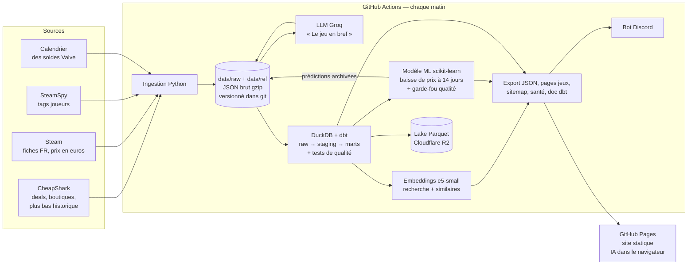

# Deal Hunter

Les promos sur les jeux PC, comparées entre une trentaine de boutiques, avec l'historique des prix pour savoir si une promo vaut vraiment le coup, une **prévision de baisse de prix à 14 jours** par machine learning, une recherche en langage naturel (« un roguelike pas cher pour jouer à deux ») et un résumé IA « Le jeu en bref » pour chaque jeu.

**Site : https://slfire.github.io/deal-hunter/** · [Les chiffres du marché](https://slfire.github.io/deal-hunter/insights.html) · [Santé du pipeline](https://slfire.github.io/deal-hunter/sante.html) · [Documentation des données](https://slfire.github.io/deal-hunter/docs/)

Le projet est un pipeline de données complet qui tourne seul chaque matin, sans serveur et sans coût : ingestion de cinq sources, warehouse DuckDB modélisé et testé avec dbt, modèle de prédiction réentraîné chaque jour avec garde-fou qualité, embeddings et LLM pour la partie IA, lake Parquet, observabilité, et publication d'un site statique.

## Architecture



| Étape | Ce qu'elle fait | Code |
|---|---|---|
| Ingestion | Snapshot quotidien des ~3 000 deals (pagination, retry/backoff, User-Agent identifié), plus bas historique par lots de 25, prix Steam en euros par lots de 50 | `src/ingestion/` |
| Référentiels | Fiches Steam, tags SteamSpy : caches incrémentaux bornés par run, réponses inattendues sautées, arrêt propre si la source tombe | `src/ingestion/common.py` |
| Stockage brut | Réponses des API gardées telles quelles, compressées, horodatées par le chemin : tout peut être rejoué | `data/raw/`, `data/ref/` |
| Modélisation | Chargement idempotent (`raw._loaded_files`), puis dbt : `staging` (typage, faux zéros → NULL, dédoublonnage) et `marts` | `src/transform/`, `dbt/` |
| Qualité | 37 tests dbt (unicité, non-nullité, relations, grain, cohérence des prix, cible et anti-fuite du modèle) + 37 tests pytest en CI | `dbt/tests/`, `tests/` |
| Prédiction | Probabilité de baisse d'au moins 10 % sous 14 jours, réentraînée chaque matin, publiée seulement si le modèle est assez fiable | `src/ml/predict_drops.py` |
| IA | « Le jeu en bref » par LLM, recherche sémantique, jeux similaires | `src/ml/` |
| Publication | JSON du site, une page HTML par jeu (SEO, aperçus de partage), sitemap, bot Discord | `src/export/`, `site/` |
| Lake | Tables en Parquet partitionné, poussées sur Cloudflare R2 si configuré | `src/lake/` |
| Observabilité | Fraîcheur, volumes par jour, couverture des enrichissements, tests dbt, historique des runs | `src/export/build_health.py`, `site/sante.html` |

## Modèle de données

- **`marts.fct_price_history`** : un prix par jeu × boutique × jour, pour les offres en promo.
- **`marts.fct_game_daily_price`** : le meilleur prix du jour d'un jeu, toutes boutiques confondues, y compris celles où il n'est pas en promo (source CheapShark `/games`).
- **`marts.ml_price_drop_features`** : une ligne par jeu × jour avec les variables connues ce jour-là et la cible du modèle (a-t-il baissé dans les 14 jours suivants ?).
- **`marts.dim_games`** : un jeu par ligne, enrichi : plus bas prix historique (le plus bas entre CheapShark et nos relevés), fiche Steam, tags joueurs, mode coop, prix en euros, résumé IA « Le jeu en bref ».
- **`marts.dim_stores`**, **`marts.current_deals`**, **`marts.insights_store_stats`**.

Lignage et description de chaque colonne : [documentation dbt](https://slfire.github.io/deal-hunter/docs/), régénérée à chaque run.

## La prédiction des baisses de prix

**La question.** Pour chaque jeu en promo : le meilleur prix va-t-il baisser d'au moins 10 % dans les 14 prochains jours ? Horizon et seuil sont des variables dbt (`drop_horizon_days`, `drop_threshold`).

**Les données.** `ml_price_drop_features` calcule, pour chaque jeu et chaque jour, des variables connues ce jour-là uniquement (fenêtres SQL tournées vers le passé) : réduction du jour, écart avec le plus bas historique, évolution récente, nombre de boutiques en promo… La cible n'existe que lorsque les 14 jours suivants sont passés. Deux tests dbt le vérifient : pas de cible sur une fenêtre incomplète, pas de variable qui regarde le futur. Aucune variable d'identité du jeu (note, notoriété) : avec quelques semaines d'historique, le modèle apprendrait des noms de jeux au lieu de profils de prix.

**Le modèle.** Gradient boosting (`HistGradientBoostingClassifier` de scikit-learn), réentraîné chaque matin sur toutes les fenêtres complètes.

**L'évaluation.** Validation croisée **groupée par jeu** : chaque prévision est faite par un modèle qui n'a jamais vu ce jeu. Un premier découpage simple dans le temps donnait une AUC de 0,96, trop belle pour être vraie : les mêmes jeux et les mêmes promos se retrouvaient des deux côtés. Au 16 novembre 2026, sur 21 jours de relevés (10 542 situations, 2 077 jeux) :

| | Valeur |
|---|---|
| AUC (hasard = 0,5) | 0,79 |
| Taux de baisse « au hasard » | 14 % |
| Taux de baisse réel des jeux classés « Bonne chance de baisse » | 48 % (3,4 fois plus) |
| Score de Brier vs prévision constante | −16 % d'erreur |

**Le garde-fou.** Si l'AUC passe sous 0,65 ou que les données manquent, rien n'est publié : le site garde son verdict habituel. Le site n'affiche pas la probabilité brute mais, pour la tranche du jeu, la part de jeux qui ont *réellement* baissé (« environ 5 sur 10 »).

**Le bilan réel.** Chaque prévision publiée est archivée (`data/ref/predictions/`). Quatorze jours plus tard, le pipeline vérifie si elle s'est réalisée et l'affiche sur la [page Santé](https://slfire.github.io/deal-hunter/sante.html#modele), à côté de l'historique des scores (`data/ref/model_runs.json`).

**Les limites.** Le modèle ne connaît pas les soldes annoncés (aucune grande soldes Steam n'est encore tombée dans l'historique), et 21 jours de données, c'est peu : les scores évolueront.

## La partie IA

**Recherche en langage naturel.** Chaque jeu est résumé en un texte (tags joueurs en tête, genres, mode coop, développeur, description) puis transformé en vecteur par `multilingual-e5-small` (ONNX quantifié, stocké en int8). Dans le navigateur, les contraintes de la phrase deviennent de vrais filtres (« pas cher », « à deux », « bien noté »…), le reste est vectorisé sur place avec Transformers.js et **exactement le même fichier de modèle**. Le score combine proximité de sens, mots retrouvés dans les tags et un léger bonus qualité. Aucune clé, aucun serveur.

**Jeux similaires.** Les 6 voisins les plus proches de chaque jeu dans l'espace des embeddings, en écartant les éditions du même jeu.

**Le jeu en bref.** Un LLM (via l'API gratuite de Groq, modèle choisi automatiquement parmi ceux disponibles, ou n'importe quelle API compatible OpenAI) résume chaque jeu en une phrase, dit pour qui il est fait et cite trois caractéristiques marquantes. Il n'a le droit de s'appuyer que sur la fiche officielle Steam et les tags des joueurs, et le site l'affiche comme tel : ce n'est pas un résumé des avis. La sortie est en JSON, contrôlée avant publication, et un résumé n'est régénéré que si sa source change (empreinte de la fiche et des tags).

*Historique : la première version résumait les avis des joueurs, mais l'endpoint public des avis Steam (`/appreviews`) redirige vers la page d'accueil depuis octobre 2026, y compris hors des serveurs de GitHub. Plutôt que de présenter autre chose comme « l'avis des joueurs », la fonction a été recentrée sur la fiche du jeu. Le LLM passait d'abord par GitHub Models, retiré par GitHub le 30 juillet 2026 : d'où une configuration indépendante du fournisseur.*

## Options à activer (facultatif)

Tout fonctionne sans configuration supplémentaire. Ces options s'activent en ajoutant des secrets au repo (Settings → Secrets and variables → Actions) :

| Option | Secrets | Comment |
|---|---|---|
| Bot Discord | `DISCORD_WEBHOOK_URL` | Salon Discord → Modifier → Intégrations → Webhooks → Nouveau → Copier l'URL |
| Lake sur Cloudflare R2 | `R2_ACCOUNT_ID`, `R2_ACCESS_KEY_ID`, `R2_SECRET_ACCESS_KEY`, `R2_BUCKET` | Compte Cloudflare gratuit → R2 → créer un bucket → créer un jeton d'API R2 |
| Nom de domaine | variable `SITE_URL` | Settings → Pages → Custom domain, puis `SITE_URL=https://ton-domaine.fr/` |
| « Le jeu en bref » (IA) | `LLM_API_KEY` | Compte gratuit sur console.groq.com (sans carte) → API Keys → Create. Autre fournisseur : variables `LLM_BASE_URL` et `LLM_MODEL` (ex. Mistral : `https://api.mistral.ai/v1`, `mistral-small-latest`) |

## Lancer en local

```bash
python -m venv .venv && source .venv/bin/activate
pip install -r requirements.txt
echo "DEALHUNTER_CONTACT=ton.mail@example.com" > .env

python src/ingestion/snapshot.py --max-pages 3     # quelques pages de deals
python src/ingestion/games_info.py                 # plus bas historique
python src/transform/build_warehouse.py            # chargement + dbt build
python src/ml/predict_drops.py                     # modèle de prédiction (a besoin de 14 jours de relevés)
python src/export/export_site_data.py
python src/export/build_pages.py
python -m http.server -d site 8000                 # http://localhost:8000

python -m pytest                                   # tests
```

## Choix techniques

- **DuckDB plutôt qu'un serveur** : quelques millions de lignes à terme, un seul fichier, zéro administration, supporté nativement par dbt.
- **Le brut est la source de vérité, le warehouse est jetable** : il est reconstruit entièrement chaque matin en quelques secondes. Conséquence assumée : pas de modèles dbt incrémentaux ni de snapshots dbt, qui n'apportent rien tant que la reconstruction complète est aussi rapide. Ils deviendront utiles quand le volume l'exigera.
- **Le brut versionné dans git** : ~100 Mo par an compressé, chaque snapshot est traçable. Le lake Parquet sur R2 prend le relais pour l'analyse à distance.
- **Les enrichissements ne bloquent jamais la mise en ligne** : si Steam, SteamSpy ou le LLM tombent, le site est publié avec les données disponibles, et la page Santé le montre.
- **Tests dbt en `warn`** : une anomalie de données prévient sans bloquer ; une erreur de modèle bloque.

## Prochaines étapes

- Premier bilan réel des prédictions publiées, à partir du 30 novembre 2026.
- Ajouter la proximité des grandes soldes Steam comme variable, une fois que les soldes d'hiver seront dans l'historique.

## Sources

Prix et boutiques : [CheapShark](https://www.cheapshark.com) · Fiches et prix en euros : Steam · Tags joueurs : [SteamSpy](https://steamspy.com) · Calendrier des soldes : annonce officielle de Valve.
